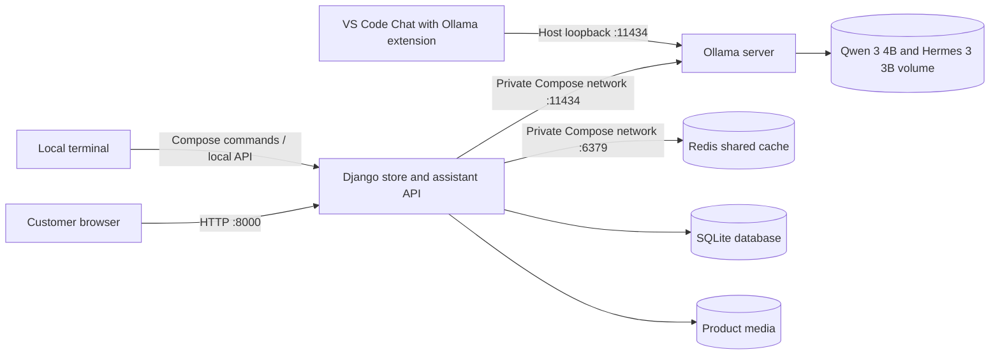

# Project Architecture

## Overview

The project combines a bilingual Django perfume store with a local Ollama inference service. Docker Compose starts the web application, Ollama, and a shared Redis cache on a private network. The Ollama API is published to the host only on `127.0.0.1:11434`, so remote computers cannot connect through this configuration.

## Request paths

1. Store pages, product data, cart and sample orders are handled by Django. The checkout is a demonstration flow and does not collect payments.
2. A question sent to `POST /api/assistant/` passes through the bilingual intent and domain-cue logic in `store/assistant_ml.py` and `store/assistant_service.py`.
3. Arithmetic expressions are evaluated locally with a restricted Python AST; catalog, price, recommendation, delivery and contact questions use project data or fixed demo responses.
4. Other everyday questions are sent to the selected local model (`qwen3:4b` or `hermes3:3b`) over Ollama's `/api/chat`. In Docker, Django uses `http://ollama:11434`; the request stays on the Compose network.
5. The public catalog API caches its safe, public-only response in Redis. Product saves and deletes bump a cache version so old catalog responses expire logically. Staff catalog responses bypass the public cache.
6. The assistant endpoint uses a cache-backed request throttle. Running more than one Django process therefore shares the same limit when `CACHE_URL` points to Redis.
7. VS Code's official Ollama extension talks to the host-published endpoint at `http://127.0.0.1:11434`. This provides direct model chat, not the website's extra intent classifier or store-catalog routing.

## Infrastructure as code

- `Dockerfile` builds the Django application image and installs pinned Python requirements.
- `compose.yaml` declares the `web`, `cache`, `ollama`, and `ollama-models` services, dependency ordering, health checks, local port binding, environment variables, and persistent model volume.
- The `ollama-models` one-shot service checks for `hermes3:3b` and `qwen3:4b` and pulls a missing model on the first internet-connected setup. It exits after setup; that exit is expected.

## Optional scalability/security lab

`compose.scale.yaml` is a separate, lighter stack that does not download Ollama models. `scripts/start-scale-demo.sh` generates local-only secrets, builds the app image, and starts three Gunicorn web containers. HAProxy discovers the replicas through Docker DNS, balances requests, redirects HTTP to HTTPS, and serves a self-signed RSA certificate generated into a named volume. The HAProxy stats page is bound to host loopback only.

The stack uses PostgreSQL streaming replication. `scale-init` runs migrations and seeds the demo catalog once on the primary. `store.db_routers.ProductReadReplicaRouter` routes only catalog product reads to the replica; user accounts, sessions, carts, writes, checkout, and administration stay on the primary because asynchronous replication can lag. Redis remains shared between web replicas for catalog caching and assistant throttling.

The lab is a single-machine demonstration. Its bind-mounted media directory, self-signed certificate, and Compose networking are not substitutes for shared object storage, trusted TLS certificates, secret rotation, backups, monitoring, or a production orchestrator. `deploy/kubernetes/perfume-web.yaml` supplies a Deployment, ClusterIP load-balancing Service, and CPU-based HPA as a cluster configuration example. It requires Metrics Server plus reachable database, replica, Redis, and Ollama services and a separately created Secret; it does not deploy cloud infrastructure by itself.

## Local operation and boundaries

Internet is required the first time if Docker images, the Ollama image, Python packages, or model files are missing. Once all are present, the default site and local model inference can run without internet. The VS Code Ollama chat path is local; some Copilot features that use GitHub services remain online-only. The default Compose port mapping intentionally prevents direct access from another computer. Do not expose Ollama or Django publicly with the development configuration. The lightweight default uses SQLite and one Django container; use the separate scale lab for a single-host load-balancing, TLS, and PostgreSQL replication demonstration. Multi-host production still requires shared media storage and managed infrastructure.

## Main code locations

| Path | Responsibility |
| --- | --- |
| `store/assistant_ml.py` | Bilingual text normalization, intent classification and product ranking |
| `store/assistant_service.py` | Arithmetic, store-specific replies and Ollama fallback |
| `store/api.py` | Assistant and store API endpoints |
| `store/templates/base.html` | Bilingual storefront interface and assistant client |
| `compose.yaml` | Local multi-service environment |
| `compose.scale.yaml` | Optional HAProxy/TLS/Gunicorn/PostgreSQL replication lab |
| `deploy/kubernetes/perfume-web.yaml` | Kubernetes web Deployment, Service, and HPA example |
| `.vscode/settings.json` | Workspace connection to local Ollama and BYOK chat support |
