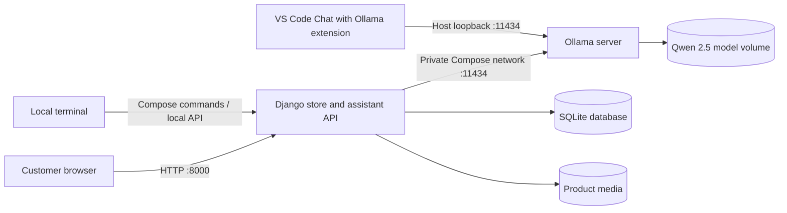

# Project Architecture

## Overview

The project combines a bilingual Django perfume store with a local Ollama inference service. Docker Compose starts the web application and Ollama on the same private network. The Ollama API is published to the host only on `127.0.0.1:11434`, so remote computers cannot connect through this configuration.

## Request paths

1. Store pages, product data, cart and sample orders are handled by Django. The checkout is a demonstration flow and does not collect payments.
2. A question sent to `POST /api/assistant/` passes through the bilingual intent and domain-cue logic in `store/assistant_ml.py` and `store/assistant_service.py`.
3. Arithmetic expressions are evaluated locally with a restricted Python AST; catalog, price, recommendation, delivery and contact questions use project data or fixed demo responses.
4. Other everyday questions are sent to the selected local Qwen model over Ollama's `/api/chat`. In Docker, Django uses `http://ollama:11434`; the request stays on the Compose network.
5. VS Code's official Ollama extension talks to the host-published endpoint at `http://127.0.0.1:11434`. This provides direct model chat, not the website's extra intent classifier or store-catalog routing.

## Infrastructure as code

- `Dockerfile` builds the Django application image and installs pinned Python requirements.
- `compose.yaml` declares the `web`, `ollama`, and `ollama-models` services, dependency ordering, health checks, local port binding, environment variables, and persistent model volume.
- The `ollama-models` one-shot service checks for `qwen2.5:1.5b` and `qwen2.5:3b` and pulls a missing model on the first internet-connected setup. It exits after setup; that exit is expected.

## Local operation and boundaries

Internet is required the first time if Docker images, the Ollama image, or model files are missing. Once all are present, the site and local model inference can run without internet. The VS Code Ollama chat path is local; some Copilot features that use GitHub services remain online-only. The Compose port mapping intentionally prevents direct access from another computer. Do not expose Ollama or Django publicly with the development configuration.

## Main code locations

| Path | Responsibility |
| --- | --- |
| `store/assistant_ml.py` | Bilingual text normalization, intent classification and product ranking |
| `store/assistant_service.py` | Arithmetic, store-specific replies and Ollama fallback |
| `store/api.py` | Assistant and store API endpoints |
| `store/templates/base.html` | Bilingual storefront interface and assistant client |
| `compose.yaml` | Local multi-service environment |
| `.vscode/settings.json` | Workspace connection to local Ollama and BYOK chat support |
