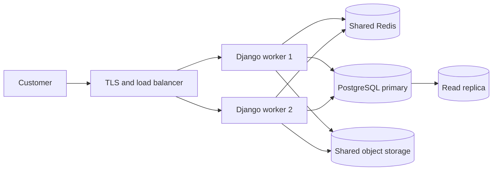

# CS50 Web Weeks 7 and 8 — PERFUME project application

This note maps the CS50 Web lessons to working code in this project and gives a repeatable demonstration path.

## Week 7 — Testing, CI/CD

| Lesson concept | Application in PERFUME | Evidence / command |
| --- | --- | --- |
| Unit and Django tests | Covers registration and saved delivery details, authentication, anonymous-cart merge, checkout totals and stock updates, ownership checks, API permissions, assistant validation, and XSS escaping. | `python manage.py test` |
| Selenium browser testing | Opens the English storefront in Chrome, adds a fragrance, and verifies that it appears in the cart. | `RUN_BROWSER_TESTS=1 python manage.py test e2e` |
| Continuous integration | GitHub Actions installs dependencies and runs Django checks, the test suite, browser test, deployment security check, and Docker image build on pushes and pull requests. | `.github/workflows/ci.yml` |
| Docker | The application image is built in CI; Compose runs the website, local model service, model setup, and shared Redis cache. | `docker build -t perfume-project:local .` and `docker compose up --build -d` |
| Test-driven workflow | For a new behavior, write a focused failing test, implement the smallest change, then run the full suite and browser flow. | CI run and local test output |

## Week 8 — Scalability and Security

| Lesson concept | Application in PERFUME | Evidence / boundary |
| --- | --- | --- |
| Caching | The public product API response and bilingual home-page content use a shared Redis cache in Compose. Product updates bump a cache version so old catalog responses are not reused. | `store/api.py`, `store/models.py`, `store/signals.py`, `compose.yaml` |
| Reducing database work | A compound product index supports the availability, stock, and newest-first catalog query. | Migration `store/migrations/0004_product_product_public_catalog_idx.py` |
| Abuse protection | The public assistant API is limited to 30 requests per hour per client using Django REST Framework's cache-backed scoped throttle. | `store/api.py`, `config/settings.py`; covered by `CacheAndThrottleTests` |
| HTTPS and public-key cryptography | Production mode turns on HTTPS redirects, secure session/CSRF cookies, HSTS, content-type protection, and a strict referrer policy. TLS public-key certificates are terminated by the deployment host or trusted proxy; production mode refuses the development secret key. | `config/settings.py`; `DJANGO_DEBUG=0 python manage.py check --deploy` |
| CSRF and XSS | CSRF middleware and form tokens protect state-changing requests. Django template auto-escaping and text-only DOM updates keep user-controlled text from being executed as markup. | `store/templates/`, `store/static/store/js/main.js`; covered by tests |
| Public/private API access | Product writes and store-content changes require staff permissions; cached catalog output contains only public inventory. Staff inventory responses bypass the public cache. | `store/api.py`; covered by `StoreAPIPermissionTests` |
| Load balancing and autoscaling | The app is containerized and the cache is shared across web processes, which is a prerequisite for more than one web worker. The current demo is a single web service. | A real load balancer/autoscaler requires a public host and deployment credentials. |
| Database replication | Not enabled in this educational local setup: it uses SQLite and local media. A production multi-instance deployment should move to managed PostgreSQL and shared object storage before adding read replicas. | `docs/architecture.md` |

The last two items are documented as the next infrastructure step instead of pretending SQLite and one local container already provide horizontal scaling or database replication.

This is the scale-out design to present with the current Redis cache. The checked-in Compose setup runs one Django service and SQLite, so the diagram is a documented next step rather than a claim that replicas are already live.

## Demonstration checklist

1. Run `python manage.py test` and show the passing result.
2. Run `RUN_BROWSER_TESTS=1 python manage.py test e2e` where Chrome and the development requirements are installed.
3. Show the successful GitHub Actions run and its uploaded `perfume-browser-test` artifact.
4. In the local Compose deployment, add/update a product from the staff dashboard and refresh `/api/products/` to demonstrate cache invalidation.
5. Explain that production mode requires a real secret, a real host, and TLS termination; never use the local Compose values as public production settings.
