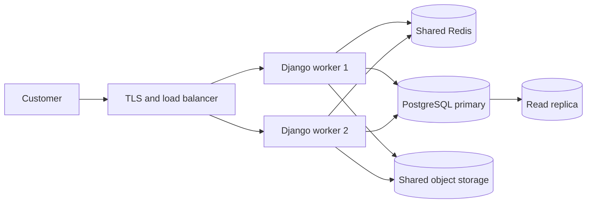

# CS50 Web Weeks 7 and 8 — PERFUME project application

This note maps the CS50 Web lessons to working code in this project and gives a repeatable demonstration path.

## Week 7 — Testing, CI/CD

| Lesson concept | Application in PERFUME | Evidence / command |
| --- | --- | --- |
| Unit and Django tests | Covers registration and saved delivery details, authentication, anonymous-cart merge, checkout totals and stock updates, ownership checks, API permissions, assistant validation, and XSS escaping. | `python manage.py test` |
| Selenium browser testing | Opens the English storefront in Chrome, adds a fragrance, and verifies that it appears in the cart. | `RUN_BROWSER_TESTS=1 python manage.py test e2e` |
| Continuous integration | GitHub Actions installs dependencies and runs Django checks, the test suite, browser test, deployment security check, and Docker image build on pushes and pull requests. | `.github/workflows/ci.yml` |
| Docker | The application image is built in CI; Compose runs the website, local model service, model setup, and shared Redis cache. | `docker build -t perfume-project:local .` and `docker compose up --build -d` |
| Test-driven workflow | Router contract tests define that catalog reads use the replica, writes use the primary, and unrelated data stays on the primary. Run the focused tests while changing the router, then run the full suite and CI. | `store/tests.py`, `store/db_routers.py`; `python manage.py test store.tests.ProductReadReplicaRouterTests` |

For a new change, follow the lesson's red-green loop: write a focused test first and confirm it fails, make the smallest implementation, then rerun the focused test, full suite, and browser test. GitHub Actions repeats the checks on pushes and pull requests.

## Week 8 — Scalability and Security

| Lesson concept | Application in PERFUME | Evidence / boundary |
| --- | --- | --- |
| Caching | The public product API response and bilingual home-page content use a shared Redis cache in Compose. Product updates bump a cache version so old catalog responses are not reused. | `store/api.py`, `store/models.py`, `store/signals.py`, `compose.yaml` |
| Reducing database work | A compound product index supports the availability, stock, and newest-first catalog query. | Migration `store/migrations/0004_product_product_public_catalog_idx.py` |
| Abuse protection | The public assistant API is limited to 30 requests per hour per client using Django REST Framework's cache-backed scoped throttle. | `store/api.py`, `config/settings.py`; covered by `CacheAndThrottleTests` |
| HTTPS and public-key cryptography | The optional lab generates an RSA certificate for localhost and terminates TLS in HAProxy. The certificate demonstrates a public/private key identity in a TLS handshake; Django trusts the proxy protocol header and sets secure cookies. The production settings additionally enforce HTTPS, HSTS, and refuse the development secret key. | `compose.scale.yaml`, `deploy/haproxy/haproxy.cfg`, `config/settings.py`; `curl -k -I https://localhost:8443/en/` |
| CSRF and XSS | CSRF middleware and form tokens protect state-changing requests. Django template auto-escaping and text-only DOM updates keep user-controlled text from being executed as markup. | `store/templates/`, `store/static/store/js/main.js`; covered by tests |
| Public/private API access | Product writes and store-content changes require staff permissions; cached catalog output contains only public inventory. Staff inventory responses bypass the public cache. | `store/api.py`; covered by `StoreAPIPermissionTests` |
| Load balancing | The local lab starts three Gunicorn app containers behind HAProxy round-robin routing. The HAProxy stats page exposes backend health and request counts. | `compose.scale.yaml`, `deploy/haproxy/haproxy.cfg`; <http://localhost:8404/stats> |
| Autoscaling | The Kubernetes HPA manifest declares a 2–6 pod range with a 70% CPU target and scale-up/down stabilization. Docker Compose scaling is manual; it is not described as autoscaling. | `deploy/kubernetes/perfume-web.yaml`; requires Kubernetes and Metrics Server to run |
| Database replication | The lab creates a PostgreSQL primary and an asynchronous streaming standby. A Django router sends catalog product reads to the replica; writes and user/order workflows stay on the primary. | `compose.scale.yaml`, `deploy/postgres/primary-init.sh`, `store/db_routers.py`, router tests |

The lightweight default remains one Django container with SQLite. The optional local lab demonstrates multiple web replicas, a real PostgreSQL standby, and HTTPS on one computer. Kubernetes autoscaling is provided as deployable configuration but still needs a cluster and its supporting services; no public cloud deployment or production-grade high availability is claimed. Local media is shared through a host bind mount and is not suitable for multi-host production use.

The optional Compose lab implements the browser-to-TLS-proxy, web-replica, Redis, PostgreSQL-primary, and PostgreSQL-standby path locally. The HPA portion requires Kubernetes, while production should use managed storage and certificates.

## Demonstration checklist

1. Run `python manage.py test`; router tests cover product read routing, primary writes, and fallback when a replica is absent.
2. Run `RUN_BROWSER_TESTS=1 python manage.py test e2e` where Chrome and the development requirements are installed.
3. Show the successful GitHub Actions run and its uploaded `perfume-browser-test` artifact.
4. Start the optional lab with `sh scripts/start-scale-demo.sh`; check HTTPS and HTTP-to-HTTPS redirection with the README commands.
5. Open HAProxy stats and confirm that all three web backends are healthy; send repeated requests and inspect request counts.
6. Query `pg_stat_replication` on the primary and read a product from the replica to demonstrate streaming replication and Django routing.
7. For autoscaling, follow `deploy/kubernetes/README.md` to prepare a Kubernetes cluster with Metrics Server and the PostgreSQL/Redis/Ollama services, create the runtime Secret, apply the migration job and web/HPA manifests, then inspect `kubectl get hpa,pods` while generating CPU load.
8. Explain that the local TLS certificate is self-signed, the Compose lab is single-host only, and production needs a trusted certificate, protected secrets, shared media storage, and an operational cluster.
